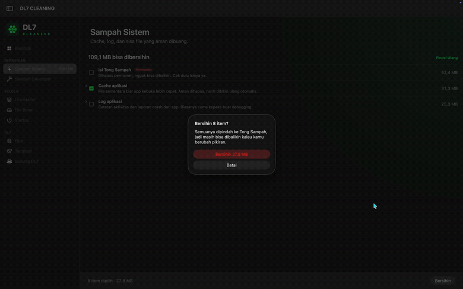

<div align="center">

# DL7 CLEANING

### A cleaner built for Apple.

**Native experience · Transparent cleanup · Your colors, your workspace**

[](docs/INSTALL.md)
[](docs/INSTALL.md)
[](Companions/)
[](LICENSE)

[**Demo**](#demo-aplikasi) · [**Instalasi**](#instalasi-cepat) · [**Fitur**](#fitur-utama) · [**Tema**](#tampilan-dan-personalisasi) · [**Kontribusi**](CONTRIBUTING.md)

</div>

---

## Demo aplikasi

<div align="center">

[](docs/media/dl7-cleaning-demo.mp4)

**▶ [Tonton demo lengkap — 36 detik (MP4)](docs/media/dl7-cleaning-demo.mp4)**

<sub>Rekaman langsung di macOS: pemindaian, pemilihan item, pembersihan, uninstaller, dan navigasi fitur.</sub>

</div>

DL7 CLEANING adalah aplikasi utilitas Apple dengan antarmuka premium, pengenalan perangkat otomatis, navigasi bawaan Apple, dan kontrol warna yang dapat dipersonalisasi. Versi macOS mengadaptasi engine open-source [Havus](https://github.com/XNyetok/Havus) (MIT), sementara versi perangkat lain menggunakan SwiftUI dan mengikuti batas keamanan platform Apple.

## Fitur utama

| Modul | Fungsi | Platform |
| :--- | :--- | :--- |
| ✦ **Sampah Sistem** | Memindai cache, log, dan file sisa yang dapat dibersihkan | macOS |
| ⚒ **Sampah Developer** | Memeriksa sisa build dan cache alat pengembangan | macOS |
| ◈ **Uninstaller** | Meninjau aplikasi dan berkas terkait sebelum menghapus | macOS |
| ▤ **File Besar** | Menemukan file yang menggunakan ruang penyimpanan | macOS |
| ⏻ **Startup** | Meninjau item dan agen startup | macOS |
| ◉ **Deteksi Perangkat** | Menyesuaikan antarmuka dengan jenis perangkat | Apple companions |
| ◐ **Tema Kustom** | Mengatur warna aksen, latar belakang, dan teks secara terpisah | Mac & iPhone |
| ♡ **Dukung DL7** | Donasi sukarela melalui alamat kripto | Mac & iPhone |
| ↗ **DEVELOPER** | Membuka [portofolio developer](https://dahlah7-personal-portfolio1.vercel.app) di browser bawaan | Mac & iPhone |

> **Prinsip keamanan:** Pemindaian tidak otomatis menghapus data. Aplikasi meminta pilihan dan konfirmasi pengguna untuk tindakan yang menghapus data.

> **Status terbaru: macOS v0.4.4 / iPhone v0.4.1.** Kedua versi berhasil dibangun, dipasang, dan dijalankan di Mac Intel serta iPhone 11 pada 7 November 2026. Saat ini **tidak ada APK, IPA universal, DMG bernotarisasi, TestFlight, atau rilis App Store**. Pengguna lain membangun aplikasi menggunakan Mac dan Xcode. Perbaikan layout sidebar macOS v0.4.3 tetap dipertahankan. Target lainnya masih eksperimental.

## Instalasi cepat

### Satu perintah, pilih perangkat

Salin **satu baris** berikut ke **Terminal di Mac**. Installer akan menampilkan menu Mac, iPhone, iPad, Mac + iPhone, Apple Watch, Apple TV, Vision Pro, atau semuanya:

```bash
/bin/zsh -c 'f="$(mktemp -t dl7-install)"; curl -fsSL https://raw.githubusercontent.com/dahlah77/dl7-cleaning/main/scripts/install.sh -o "$f" && /bin/zsh "$f"; result=$?; /bin/rm -f "$f"; exit "$result"'
```

**Mac:** installer menyiapkan source, build, mencadangkan instalasi yang akan diganti, memasang, lalu membuka aplikasi. **iPhone/iPad/Watch/TV/Vision:** installer menyiapkan proyek dan membuka Xcode; pengguna tetap perlu memilih perangkat dan menyelesaikan *code signing* sebelum menekan **Run ▶**. Proses Apple ini tidak dapat dilewati oleh sebuah skrip terminal.

**[Lihat semua pilihan, mode otomatis, dan panduan untuk pemula →](docs/INSTALL.md)** · [Baca source installer](scripts/install.sh)

<details>
<summary><b>Alternatif: instalasi manual untuk developer</b></summary>

**Belum pernah menggunakan Xcode?** Baca [Panduan Instalasi Lengkap Bahasa Indonesia](docs/INSTALL.md) terlebih dahulu.

Untuk memulai dari source:

```bash
git clone https://github.com/dahlah77/dl7-cleaning.git
cd dl7-cleaning
zsh scripts/build-macos.sh
```

Skrip menghasilkan aplikasi Mac dalam folder `dist`, tanpa menghapus pemasangan sebelumnya. Untuk perangkat selain macOS, gunakan `zsh scripts/open-apple-project.sh` dan ikuti panduan Xcode.

| Perangkat | Langkah awal | Status |
| --- | --- | --- |
| **Mac** | `zsh scripts/build-macos.sh` → buka folder `dist` → pindahkan `.app` ke Applications | Build + pemasangan diuji |
| **iPhone & iPad** | `zsh scripts/open-apple-project.sh` → pilih `DL7iOS` → pilih perangkat → Run ▶ | iPhone 11 diuji; iPad belum |
| Apple Watch | Pilih `DL7watchOS` di Xcode | Target eksperimental |
| Apple TV | Pilih `DL7tvOS` di Xcode | Target eksperimental |
| Apple Vision Pro | Pilih `DL7visionOS` di Xcode | Target eksperimental |

**Persiapan:** Mac dengan Xcode, internet, dan XcodeGen untuk target selain macOS (`brew install xcodegen`). Untuk memasang ke perangkat fisik, gunakan Apple Account untuk signing serta Developer Mode bila diminta. Profil gratis *Personal Team* kedaluwarsa setelah 7 hari.

</details>

## Tampilan dan personalisasi

Palet referensi bawaan:

| Parameter | Warna |
| --- | --- |
| 🟢 Accent / Aksen | `#1EFF5A` |
| ⚫ Background / Latar belakang | `#040805` |
| 🟦 Foreground / Latar depan | `#3DFFF5` |

Ketiganya dapat diubah sendiri-sendiri melalui color picker atau kode HEX dan disimpan secara lokal. Setelan warna iPhone dan Mac **tidak otomatis disinkronkan**.

- iPhone/iPad: **Beranda • Bersihkan • Fitur • Setelan**.
- Mac: dashboard, sidebar native, tool cleanup DL7, **Fitur**, **Tampilan**, dan **Dukung DL7**.
- Satu navigasi **Fitur** menjelaskan kemampuan aplikasi tanpa memenuhi halaman utama dengan teks panjang.
- Navigasi **DEVELOPER** membuka portofolio lewat browser eksternal tanpa mengubah data aplikasi.

## Kemampuan & batasan

**macOS:** pemindaian sampah sistem/developer, uninstaller, file besar, startup items (menggunakan modul pembersih open-source yang diadaptasi untuk DL7). Penghapusan tetap mengikuti pilihan dan konfirmasi pengguna. Beberapa operasi membutuhkan izin macOS.

**iOS/iPadOS:** mendeteksi perangkat, memindai cache milik DL7, membersihkan cache serta file sementara DL7 yang telah berumur lebih dari satu jam. **Apple tidak mengizinkan DL7 menghapus cache sistem, Safari, WhatsApp, atau data aplikasi lain.** Tidak ada angka penghematan palsu.

**watchOS/tvOS/visionOS:** target SwiftUI eksperimental dengan akses yang sesuai kemampuan sistem. Pengujian perangkat fisik dan penyempurnaan fitur masih diperlukan sebelum distribusi publik.

## Buy me a coffee — dukungan kripto

Tersedia UI dukungan dengan jaringan **BTC, SOL, ETH, BNB, dan USDT (BNB Smart Chain)**. Donasi sepenuhnya opsional.

<details>
<summary><b>Tampilkan alamat kripto resmi</b></summary>

| Jaringan / aset | Alamat penerima |
| --- | --- |
| Bitcoin (BTC) | `bc1papfmgppu3h0qhw64eag54k80c8gc7um8ra7llng5u9fgxnyxlllsyu7p3s` |
| Solana (SOL) | `6KdxkUkTfTAVoenCyupBHvdRaNfoDDhUzhyjc4AdUXKU` |
| Ethereum (ETH) | `0xae91783b9e196f33535a4b45ba6fe041b149f7b9` |
| BNB (BNB Smart Chain) | `0xae91783b9e196f33535a4b45ba6fe041b149f7b9` |
| USDT (BNB Smart Chain, BEP-20) | `0xae91783b9e196f33535a4b45ba6fe041b149f7b9` |

Alamat tampil otomatis dan dapat disalin; tombol explorer membantu verifikasi tujuan. **USDT harus dikirim melalui BNB Smart Chain (BEP-20), bukan ERC-20 atau jaringan lain.** Wallet link hanya muncul untuk jaringan yang memiliki deep link sederhana; aplikasi tidak membuat atau menandatangani transaksi. Selalu verifikasi jaringan dan alamat sebelum mengirim kripto.

</details>

## Struktur repository

```text
DL7-CLEANING/
├── Companions/
│   ├── project.yml           # XcodeGen: iOS/iPadOS, watchOS, tvOS, visionOS
│   ├── Shared/               # SwiftUI, warna, cache, device detection
│   ├── Assets-iOS.xcassets/
│   └── Tests/
├── MacBranding/
│   ├── RootView.swift        # UI Mac premium
│   ├── DL7App.swift
│   ├── DL7.xcconfig
│   └── apply_to_upstream_clone.sh
├── scripts/
│   ├── build-macos.sh
│   ├── install.sh           # Installer satu perintah + menu perangkat
│   ├── test-install.sh      # Smoke test tanpa menyentuh perangkat
│   ├── test-developer-link.sh # Verifikasi link eksternal Mac/iPhone
│   └── open-apple-project.sh
├── docs/INSTALL.md
├── docs/media/              # Demo video MP4 + animated preview GIF
├── LICENSE
└── LICENSE-UPSTREAM-HAVUS
```

`scripts/build-macos.sh` mengunduh source Havus pada commit terpilih, menerapkan branding dan UI DL7, lalu menghasilkan aplikasi **di direktori `dist` tanpa menghapus/mengubah aplikasi yang sudah terpasang**. Repo ini sengaja tidak mengunggah checkout Havus, cache build, provisioning profile, atau data Mac pribadi.

## Keamanan dan kontribusi

- [Kebijakan Keamanan](SECURITY.md) — cakupan izin, penghapusan, dan pelaporan kerentanan.
- [Panduan Kontribusi](CONTRIBUTING.md) — cara membangun, menguji, dan membuat pull request.
- [Riwayat Versi](CHANGELOG.md).

## Lisensi dan kredit

Dirilis dengan lisensi MIT. Terima kasih kepada **Debi Kurnia** dan kontributor [XNyetok/Havus](https://github.com/XNyetok/Havus) untuk engine macOS berlisensi MIT. Pernyataan hak cipta asli tersedia di [LICENSE-UPSTREAM-HAVUS](LICENSE-UPSTREAM-HAVUS) dan harus dipertahankan dalam distribusi turunan.

Proyek ini independen dan **tidak berafiliasi atau didukung oleh Apple**.

---

<div align="center">

**DL7 CLEANING · Built with care for Apple devices.**

</div>
